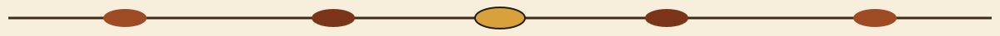
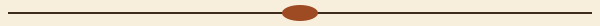

# dm-date-variance-injector

Herbarium specimen label: the name above is set in Cardo in loam, in the manner of a pressed specimen tag, with a miniature Wollemi cone sketched beside this first heading only. Later headings keep the tag manner without the miniature. This theme entry is partial: it supplied theme, world, fit, palette, font, and story only. The directions it did not supply were authored from that surviving material and are flagged as authored where they appear. A formal completion of the entry is still owed.

# dm-date-variance-injector
Introduces a random variance within a specified range to date values, preserving the temporal relationships while obscuring exact dates. Useful for masking date of birth or service initiation dates. - Focused on Tools designed to generate or mask sensitive data with realistic-looking but meaningless values

## Install
`git clone https://github.com/ShadowStrikeHQ/dm-date-variance-injector`

> Specimen tag: the housed clone line names an older organisation.

## Usage
`./dm-date-variance-injector [params]`

> Specimen tag: no input form, no date format, and no output destination is stated anywhere in the housed text. Those are absences, printed as absences.

## Parameters
- `-h`: Show help message and exit
- `-r`: The range of days to vary the date by. A positive value draws only into the future, from 1 to the range. A negative value draws only into the past, from the range to -1.
- `-m`: No description provided
- `-f`: No description provided
- `-s`: Optional seed for the shared offset draw, so a run can be reproduced.

One run can take one or more dates. All dates in a single run share one drawn offset, so their order is preserved: a later date in the input stays later in the output. Dates masked in separate runs do not share an offset. With --seed, the shared offset is the seeded draw, so the same seed and range reproduce the same shift for the whole set.

> Specimen tag: a positive span draws exclusively forward.

> Specimen tag: a negative span draws exclusively backward.

> Specimen tag: dates split across distinct runs share zero displacement.

> Specimen tag: the seed is listed as -s in the Parameters list and spelled --seed in the shared offset paragraph above. Both spellings stand exactly as printed.

## License
Copyright (c) ShadowStrikeHQ

## One Offset, Whole Run

The main button of this re-skin reads Shift the Dates. Its range field label reads Range in Days. Its offset heading reads One Offset, Whole Run. Its silence heading reads Two Flags, Descriptions Missing. Buttons are small Wollemi pine cones in carved wood with bark still on the edge: matte at rest, a shade darker under a pointer, a shade darker still when pressed, with a double maple gold rule for keyboard focus. Cards are specimen trays and rock shelves, headings as herbarium labels in Cardo, body copy in Barlow. A card that reports separate runs carries a broken ring mark in its top corner, and no other card carries that mark.

## Gorge defects ledger

Partial entry: the theme entry arrived incomplete. It supplied a named theme and world, a fit argument, a four colour palette of autumn rust, maple gold, loam, and cream, a type ruling for Cardo and Barlow under the SIL Open Font License 1.1, a refusal to force a lettering reference where only one weak match existed, and a story in five beats. It supplied no cast list and no guidance for mark, banner, opening banner, site, kit, README, headings, finished artwork, pairing, or difference. Every prompt and scene plan for this build was authored from the surviving material, and the three scene bands above are authored from the story beat alone, flagged here as authored. Until the missing directions turn up, this repository stays owed a formal completion of its theme entry.

Identity faults: ShadowStrikeHQ appears 2 times in the live README, once in the clone line and once in the closing line. Both stand untouched here. Repairs happen on the website only, flagged as repairs there. The root licence file holds MIT terms for 2025 through 2026; its holder is described by outline only: two words forming a pen name, next a bracketed shortening that leaves a given name as one letter, last a handle sitting inside round brackets. The holder line itself is not reproduced in this re-skin prose.

Undescribed flags: -m and -f carry no description in the housed text, and none is invented here. Absences: no input form, no date format, and no output destination is stated anywhere. No redaction flags apply, and no date belonging to anybody appears anywhere in this re-skin.

The walk closes on the cone left shut in the clearing, the gorge in full leaf, the path home open, and the location still unpublished.
